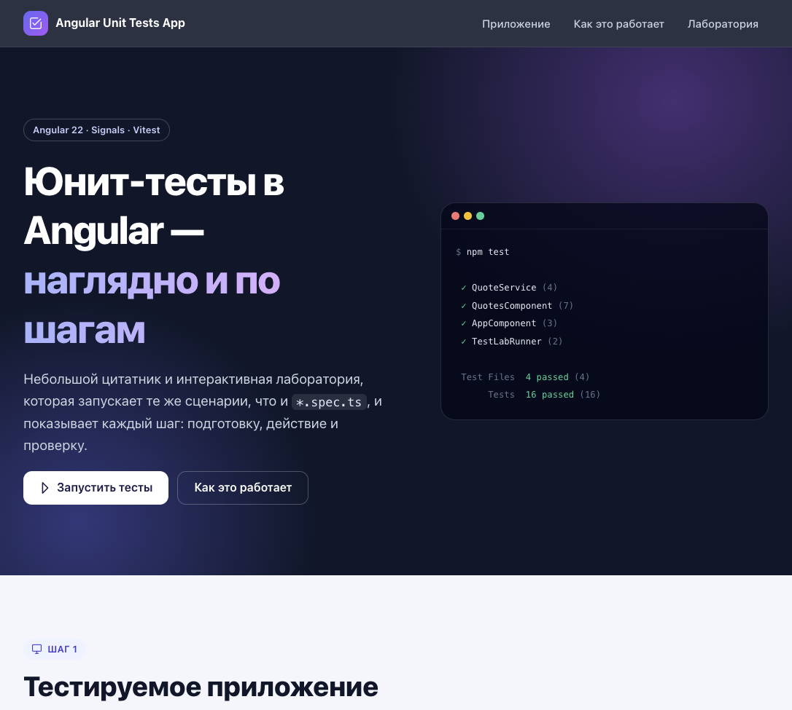
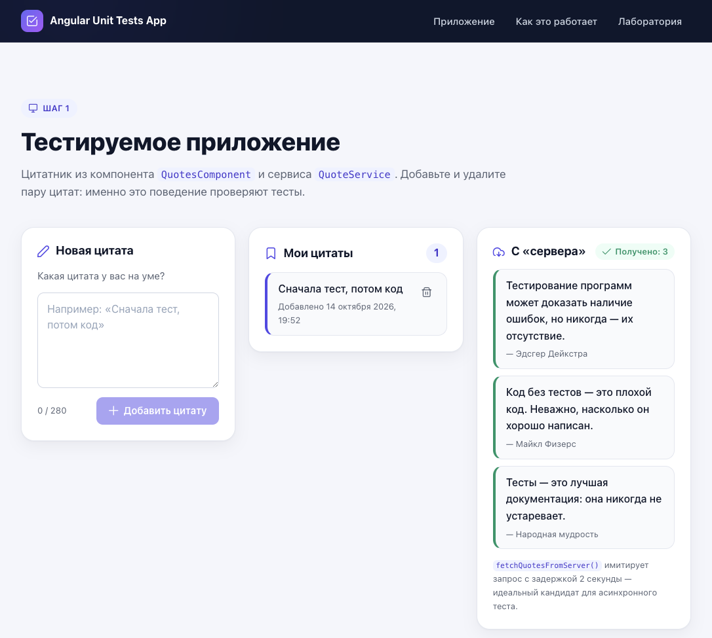
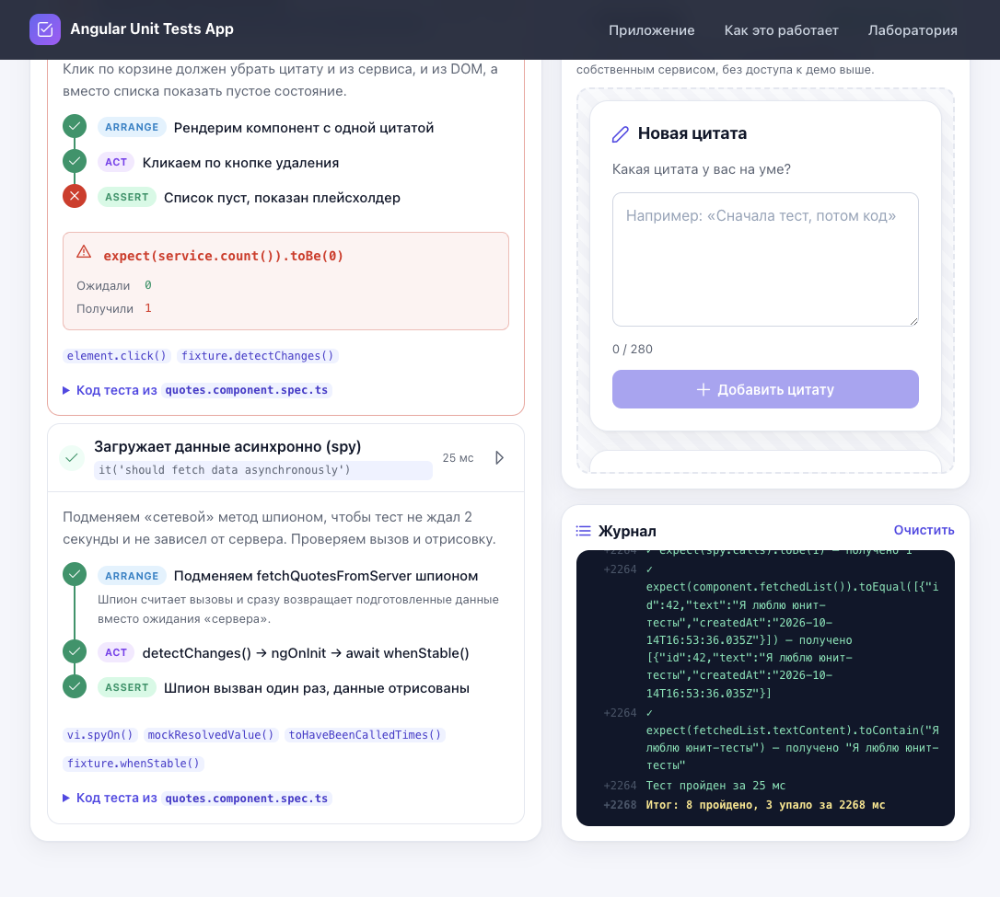

# Angular Unit Tests App

Учебное приложение о том, как устроено юнит-тестирование в Angular. Внутри небольшой цитатник, который покрыт тестами, и **интерактивная лаборатория**. Она прямо в браузере запускает те же сценарии, что и `*.spec.ts`, и пошагово показывает, что происходит внутри теста: подготовку, действие и проверку.



## Что внутри

- **Тестируемое приложение.** Компонент `QuotesComponent` и сервис `QuoteService`: добавление, удаление и асинхронная загрузка цитат с «сервера».
- **Раздел «Как устроено тестирование».** Виды тестов, что происходит после `npm test`, паттерн Arrange → Act → Assert и шпаргалка по API (`TestBed`, `ComponentFixture`, `vi.spyOn`, фейковые таймеры).
- **Лаборатория тестов:**
  - каждый сценарий разбит на шаги с цветными фазами Arrange / Act / Assert и пояснениями;
  - компонент под тестом рендерится в видимую «песочницу», и видно, как меняется DOM;
  - журнал выводит каждую проверку `expect()` с полученным значением;
  - у упавшего теста видно, на каком шаге он сломался, и блок «ожидали / получили»;
  - скорость выполнения настраивается: медленно, обычно или мгновенно, как в CI;
  - переключатель «Внести баг в QuoteService» подменяет сервис сломанной реализацией, и видно, какие тесты ловят регрессию.

| Демо-приложение | Лаборатория: упавший тест и песочница |
| --- | --- |
|  |  |

## Стек

- **Angular 22**: standalone-компоненты, signals, `computed`, новый control flow (`@if`, `@for`, `@let`), zoneless change detection, `OnPush`.
- **Vitest 5 + jsdom**: стандартный раннер Angular CLI (`@angular/build:unit-test`), заменивший Karma и Jasmine.
- **TypeScript 6** в строгом режиме (`strict`, `strictTemplates`).
- **PrimeIcons 7** (MIT): иконки. UI-компоненты собственные, без сторонних библиотек.

## Быстрый старт

Требования: **Node.js `^22.22.3`, `^24.15.0` или `>=26`**, npm 10+.

```bash
npm install
npm start            # dev-сервер на http://localhost:4200
```

| Команда | Что делает |
| --- | --- |
| `npm start` | Запускает dev-сервер с live reload |
| `npm test` | Запускает Vitest в режиме наблюдения |
| `npm run test:ci` | Однократный прогон тестов (для CI) |
| `npm run test:coverage` | Прогон с отчётом о покрытии в `coverage/` |
| `npm run build` | Production-сборка в `dist/` |

## Деплой на Netlify

Все настройки лежат в [`netlify.toml`](netlify.toml), поэтому в интерфейсе Netlify достаточно подключить репозиторий.

- **Сборка:** `npm run test:ci && npm run build`. Если хоть один тест упадёт, деплой не выполнится.
- **Каталог публикации:** `dist/Angular-Unit-Tests-App/browser`.
- **Node.js:** 22 (задано в `NODE_VERSION` и в `.nvmrc`).
- **Кэширование:** JS, CSS и шрифты с хешем в имени кэшируются на год, `index.html` всегда перепроверяется (`no-cache`), так что после деплоя пользователи сразу получают новую версию.
- **Безопасность:** базовые заголовки `X-Content-Type-Options`, `X-Frame-Options`, `Referrer-Policy`, `Permissions-Policy`.
- **SPA-fallback:** все пути отдают `index.html`, это пригодится, если в проекте появится роутинг.

Деплой из терминала через [Netlify CLI](https://docs.netlify.com/cli/get-started/):

```bash
npx netlify-cli deploy --build          # preview
npx netlify-cli deploy --build --prod   # production
```

## Структура проекта

```text
src/app/
├── app.component.*                 # каркас: шапка, hero, секции, футер
├── app.config.ts                   # провайдеры приложения (локаль ru)
└── components/
    ├── quotes/                     # тестируемое приложение
    │   ├── model/quote.model.ts
    │   ├── service/quote.service.ts
    │   ├── service/quote.service.spec.ts      # изолированные юнит-тесты
    │   ├── quotes.component.*
    │   └── quotes.component.spec.ts           # тесты компонента с DOM
    ├── testing-guide/              # раздел «Как устроено тестирование»
    └── test-lab/                   # интерактивная лаборатория
        ├── lab-scenarios.ts                   # сценарии и шаги (зеркало спек)
        ├── lab-expect.ts                      # мини-реализация expect()
        ├── test-lab-runner.service.ts         # движок запуска
        ├── test-lab-runner.service.spec.ts    # проверяет сами сценарии
        └── buggy-quote.service.ts             # сломанный сервис для демонстрации
```

## Как устроено тестирование

### Виды тестов

1. **Юнит-тесты** проверяют один класс в изоляции, без DOM, сети и Angular. `QuoteService` создаётся через `new QuoteService()` и тестируется как обычный TypeScript-класс.
2. **Компонентные тесты** работают через `TestBed`: он собирает компонент с зависимостями и рендерит шаблон в jsdom, а тест кликает и вводит текст так же, как это делал бы пользователь.
3. **E2E-тесты** (Playwright, Cypress) проверяют приложение целиком в реальном браузере. В этот проект они не входят.

### Что происходит после `npm test`

1. Билдер `@angular/build:unit-test` находит все `*.spec.ts` и собирает их через esbuild вместе с шаблонами и стилями.
2. Vitest запускает тесты в Node.js, а jsdom эмулирует DOM браузера.
3. В `beforeEach()` вызывается `TestBed.configureTestingModule()`: он описывает «мини-приложение» для теста.
4. `TestBed.createComponent()` создаёт компонент и `ComponentFixture`, через который тест управляет компонентом.
5. `fixture.detectChanges()` вызывает `ngOnInit` и применяет привязки шаблона.
6. Тест выполняет действие (клик, ввод, ожидание промиса) и сравнивает результат через `expect()`.
7. Vitest выводит отчёт: зелёные и красные тесты, diff «ожидали / получили» и при необходимости покрытие.

### Паттерн Arrange → Act → Assert

```ts
it('should enable the button when the textarea is not empty', async () => {
  // Arrange — рендерим компонент и ждём регистрации ngModel
  fixture.detectChanges();
  await fixture.whenStable();

  // Act — пользователь печатает текст
  typeQuote('Я люблю тесты');

  // Assert — кнопка стала активной
  expect(query<HTMLButtonElement>('submit-quote').disabled).toBe(false);
});
```

### Что покрыто тестами

| Файл | Что проверяется |
| --- | --- |
| `quote.service.spec.ts` | добавление, игнорирование пустого текста, удаление по `id`, асинхронная загрузка с `vi.useFakeTimers()` |
| `quotes.component.spec.ts` | создание, рендер данных из сервиса, `disabled` у кнопки, ввод текста, отправка формы, удаление, загрузка через `vi.spyOn()` |
| `app.component.spec.ts` | единственный `h1`, семантические landmarks, мобильное меню |
| `test-lab-runner.service.spec.ts` | все сценарии лаборатории проходят на настоящем сервисе и ловят ровно три регрессии на сломанном |

### Частые ловушки, которые разобраны в проекте

- **Ничего не отрисовалось.** Без `fixture.detectChanges()` не вызывается `ngOnInit` и не применяются привязки.
- **Ввод игнорируется.** `ngModel` внутри `<form>` регистрируется в `NgForm` асинхронно, поэтому перед вводом нужен `await fixture.whenStable()`.
- **Медленные асинхронные тесты.** Реальный `setTimeout` на 2 секунды заменяется на `vi.useFakeTimers()` и `vi.advanceTimersByTimeAsync()`, а «сетевой» метод подменяется через `vi.spyOn().mockResolvedValue()`.
- **Тесты влияют друг на друга.** Каждый тест получает свежий `TestBed` и новый экземпляр сервиса из `beforeEach()`.

## Как работает лаборатория

Для каждого сценария лаборатория создаёт **изолированный `EnvironmentInjector`** со своим `QuoteService`, как это делает `TestBed`. Компонент рендерится через `createComponent()` в элемент-песочницу, а детекция изменений запускается вручную, как `fixture.detectChanges()`. Поэтому демо-приложение на странице не затрагивается, а каждый шаг виден в DOM и в журнале.

Сценарии в `lab-scenarios.ts` повторяют спеки из `*.spec.ts`. Их корректность проверяет `test-lab-runner.service.spec.ts`: на настоящем сервисе все сценарии должны пройти, на `BuggyQuoteService` должны упасть ровно три.

## Что изменилось при обновлении с Angular 15

- Angular 15 → 22: `NgModule` и `AppRoutingModule` заменены на standalone-компоненты и `bootstrapApplication`, а `zone.js` больше не используется.
- Состояние переведено на signals, `*ngFor` заменён на `@for`, поле ввода связано через `[(ngModel)]` с сигналом.
- Karma и Jasmine заменены на Vitest и jsdom, все спеки переписаны. Например, старый тест искал введённый текст в `innerHTML`, хотя значение `textarea` туда не попадает, а асинхронный тест не дожидался `whenStable()`.
- Сборщик `@angular-devkit/build-angular:browser` заменён на `@angular/build:application` (esbuild + Vite).
- PrimeNG удалён: с версий 20.4 / 21.1.10 / 22 он распространяется по лицензии PrimeUI и требует ключ. Кнопки и поле ввода сделаны на собственных стилях, а initial-бандл занимает около 340 kB (≈ 82 kB в gzip). Иконки закреплены на PrimeIcons 7.0.0 — последней версии под MIT.
- Исправлен баг с датой: день недели брался из `getDate()`, а число — из `getDay()`. Теперь дата форматируется через `DatePipe` с русской локалью.
- Вёрстка семантическая (`header`, `nav`, `main`, `section`, `figure`/`blockquote`, `time`, `dl`) и доступная: skip-link, `aria-*`, `role="log"`, видимый фокус, поддержка `prefers-reduced-motion`.
- Добавлена адаптивность: мобильное меню, fluid-типографика, сетки на `auto-fit`. Цитатник использует container queries, поэтому корректно выглядит и на странице, и в узкой песочнице лаборатории.
